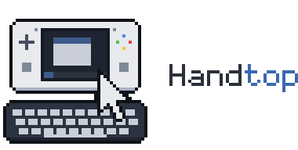
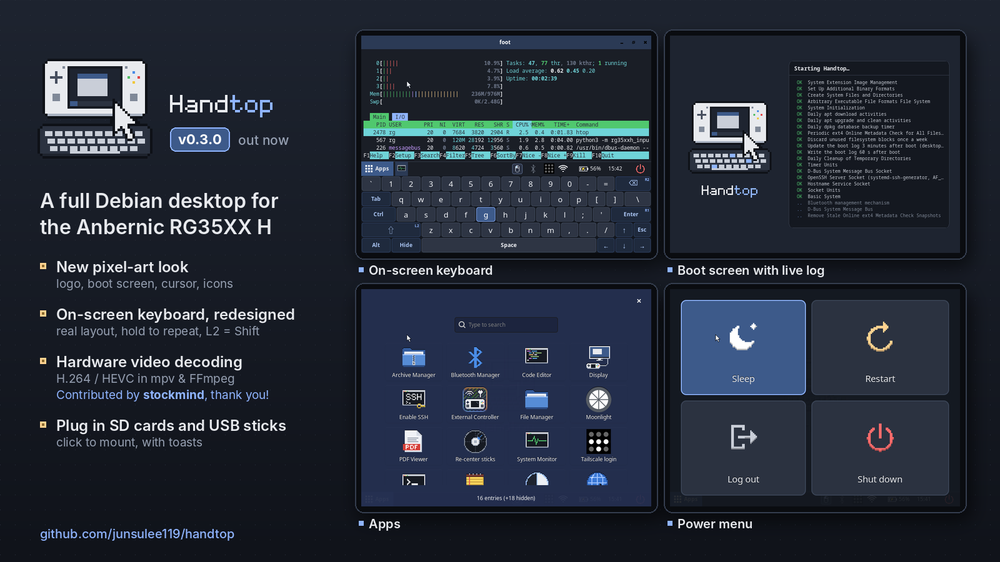

# Handtop

<p align="center">
  <picture>
    <source media="(prefers-color-scheme: dark)" srcset="media/logo/handtop-wordmark-dark.png">
    
  </picture>
</p>

A full Debian desktop for the **Anbernic RG35XX H**. It turns the handheld into a pocket
Linux computer: SSH, Moonlight remote desktop, Tailscale, a web browser, a terminal,
an external monitor over mini HDMI, and everything else Debian's arm64 archive offers.

<p align="center">
  
</p>

- **Hardware layer:** kernel, U-Boot, device trees and firmware from [ROCKNIX](https://github.com/ROCKNIX/distribution) `20261001` (kernel 7.2)
- **Userspace:** Debian 13 "trixie" (arm64)
- **Desktop:** labwc (Wayland) + Waybar + nwg-drawer + wlogout, 640×480 on the built-in screen
- **Controls:** a custom input daemon turns the gamepad into mouse + keyboard, with an on-screen keyboard

Status: **v0.3.0**, developed and tested on the RG35XX H.

<p align="center">
  
</p>

## Features

- Desktop mode by default: stick / D-pad pointer, A/B clicks, right-stick scrolling, L1/R1/R2 = Esc/Enter/Backspace, L3/R3 = copy/paste
- On-screen keyboard (X), navigable with the D-pad
- Gamepad mode (tap Start) presents an Xbox 360 pad, e.g. for Moonlight; hold Start 1 s to go back
- **BT Controller mode**: the handheld becomes a Bluetooth gamepad for your PC or phone; over a USB cable it can also be a wired Xbox 360 or **Nintendo Switch** controller
- **Moonlight** with **hardware video decoding** (H.264/HEVC up to 1080p60) via the Cedrus decoder
- **Tailscale** with tray icon and a QR-code login launcher
- **HDMI**: hot-plug, monitor-only / extend / mirror modes, keyboard panel on the handheld when the monitor is the only screen
- Sleep (s2idle) from the power menu or after 10 min idle; Power tap wakes
- Charges while switched off (power button boots)
- Wi-Fi set up from Windows/macOS by editing `wifi.txt` on the boot partition
- Chromium with uBlock Origin Lite (installed automatically on first launch when online); zram + 2 GB swap file
- Boot logs written to the FAT partition, readable from any PC

Full control map: [docs/services/input-daemon.md](docs/services/input-daemon.md).

## Install

You need a microSD card (16 GB or larger) and balenaEtcher or Rufus.

1. Download `handtop-<date>-v0.3.0.img.xz` and its `.sha256` from the Releases page. If that image does nothing at all on power-on (no LED), your unit has DDR3 RAM: use the `-DDR3` image instead.
2. Flash the `.img.xz` directly (no need to unpack). If Windows offers to format the card afterwards, choose **Cancel**.
3. Optional: on the `RG35XXHBOOT` drive, fill in `wifi.txt` (SSID, password, country).
4. Put the card in the **TF1** (left) slot and power on. The first boot takes longer (the system grows to fill the card).

> ⚠️ **Known issue:** Bluetooth is sometimes missing on the first boot after flashing (no adapter: the Bluetooth icon shows it off and External Controller → Bluetooth can't start). Restart once (Power → Restart); it works from then on.

**Login:** user `rg`, password `rg35xxh` (used for sudo). **SSH is off by default**:
open Apps → **Enable SSH**, which makes you choose your own password first.

RG35XX H units come with one of two screen panels. Handtop checks the board at every start and
uses the matching one, restarting once if it had to switch. If the screen stays garbled or black,
write `rev6` (or `regular`) in `panel.txt` on the boot partition.
Details: [docs/flashing.md](docs/flashing.md).

## External display

Plug a monitor into the mini HDMI port at any time (hot-plug). The **Display** app opens on the handheld by itself (the monitor stays dark meanwhile, so the pointer is on the handheld): pick a layout, or leave it for 5 s to keep the last one. Open it again any time from **Apps → Display**.

- **Monitor only:** the desktop moves to the monitor; the handheld screen becomes a full-size on-screen keyboard
- **Extend:** the monitor and the handheld screen form one desktop, the handheld below the monitor (move the pointer off the monitor's bottom edge, in its middle)
- **Mirror:** both show the same picture

**Resolution and refresh rate** are chosen in the same app, from the monitor's own list, and remembered per monitor. **Test** tries a mode and switches back after 15 s unless you press Keep, so a mode the screen can't show never leaves you stuck. Tested up to **1920×1080 at 240 Hz** (a real 570 MHz signal). The pointer moves faster on the monitor, in proportion to its size (`display_speed_scale` in the input config).

For a bigger UI on a 4K screen (in a terminal): `wlr-randr --output HDMI-A-1 --scale 2`.

There is no HDMI audio.

## External Controller (Bluetooth, USB cable or Switch)

Use the handheld as a game controller for your PC or phone: **Apps → External Controller**. **Bluetooth**: pair **"Handtop (Xbox)"** from the other device (first time only; it reconnects by itself afterwards). The taskbar's input-mode icon turns blue with rainbow stripes while it is on; press Select + Start + L1 + R1 to stop. Unlike gamepad mode, apps on the handheld don't see the controls. The handheld's screen shows the connection, a live view of the controls and the battery while it is on. It shows up as an Xbox Wireless Controller (Xbox-only games work, game vibration on the handheld; after updating from v0.2.0, remove and re-pair it on the PC once); while it is on, classic-Bluetooth accessories connected to the handheld pause. Details: [docs/apps/external-controller.md](docs/apps/external-controller.md).

**USB cable**: connect the handheld's right USB-C port (OTG2/DC) to a PC and pick USB cable: Xbox. It shows up as a wired Xbox 360 controller (works with Xbox-only games, game vibration on the handheld), and the handheld charges meanwhile. One connection (Bluetooth or cable) at a time.

**USB cable: Switch**: the handheld becomes a wired Nintendo Switch controller (it poses as HORI's licensed wired pad, so no setup on the Switch). Connect the right USB-C port to a USB-A port of the Switch dock with an A-to-C cable, or, without the dock, through a USB-C OTG adapter. The printed A/B/X/Y match the Switch's. **F = Home** (hold for quick settings), **F + Select = Capture**. No vibration (the pad type has none). Tested on a PC with Ryujinx (rebind A/B/X/Y once there), not on a real Switch yet: reports welcome.

**Bluetooth: Switch** (experimental): the handheld pairs with a Switch as a Pro Controller (Controllers → Change Grip/Order the first time), with vibration and the same F = Home / F + Select = Capture. Bluetooth devices connected to the handheld disconnect while it is on (the app asks first). Tested with a PC (Ryujinx), not on a real Switch yet.

**Battery saver** (switch in the app, off by default): the handheld's screen turns off 30 s after connecting; Vol+/- or Power shows it for 10 s.

## Good to know

- The device has 1 GB RAM; for heavy websites and video, Moonlight to a PC works best.
- Hardware video decoding (H.264/HEVC) is used by Moonlight; other players decode on the CPU.
- For streaming, 5 GHz Wi-Fi gives the smoothest result.
- Bluetooth devices pair from the tray (Blueman); USB keyboards and mice work through the host port.
- If a stick drifts, Apps → **Re-center sticks** recalibrates it.
- Sleep uses about 5–6 % battery per hour.

## Build it yourself

See [docs/building.md](docs/building.md). In short, on a Debian/Ubuntu host:

```sh
sudo bash build/build-rootfs.sh
sudo bash build/10-image.sh        # → work/out/handtop-<date>-<version>.img.xz
```

## Repository layout

- `build/` — numbered build scripts, package lists, kernel patch and device-tree overlay
- `overlay/` — files copied into the root filesystem
- `src/inputd/` — input daemon and on-screen keyboard (Python), with unit tests
- `boot-files/` — files placed on the FAT boot partition
- `tools/` — test helpers (QEMU boot test, headless desktop screenshots, Wi-Fi import test)
- `docs/` — how everything works and why

## Disclaimer

- **Unofficial.** Handtop is an independent hobby project. It is not affiliated with, endorsed by or supported by Anbernic, ROCKNIX, Debian, Nintendo, Microsoft, HORI or any other company or project named here.
- **Trademarks.** Anbernic and RG35XX, Nintendo Switch and Pro Controller, Xbox, Xbox 360 and Windows, HORI and the other product names are trademarks of their owners. They are used only to say what Handtop works with.
- **Controller modes.** External Controller presents the USB or Bluetooth identity of compatible controllers so that a PC or Switch can use the handheld, for interoperability only. The Switch modes are experimental and not tested on a real Switch; a console, driver or firmware update may stop any of these modes working at any time. Check the terms of any online service or game you use them with.
- **No warranty, at your own risk.** Handtop is provided "as is", without warranty of any kind (see the [license](LICENSE)). Flashing replaces everything on the microSD card; keep your stock firmware card and back up anything you need. Handtop replaces the system on the card only, never the handheld's own firmware, and nothing here changes charging limits or other power-chip settings. Still, a software fault can lock up the handheld (see [docs/hardware-safety.md](docs/hardware-safety.md)); in rare cases recovery means opening the back to disconnect the battery ([docs/flashing.md](docs/flashing.md#if-something-is-wrong)), which may affect your warranty. The authors are not liable for damage to devices, data loss or any other harm from using it.

## Credits and license

Built on the work of the ROCKNIX, Debian, labwc, Waybar, nwg-drawer, wlogout, Moonlight and
Tailscale projects, and the upstream Linux H616 video-engine patches. Inspired by
[MrJackSpade/RG35XXP-XFCE](https://github.com/MrJackSpade/RG35XXP-XFCE).
See [THIRD-PARTY.md](THIRD-PARTY.md).

This project's own scripts, configuration and code are under the [MIT License](LICENSE).
Third-party components keep their own licenses.
