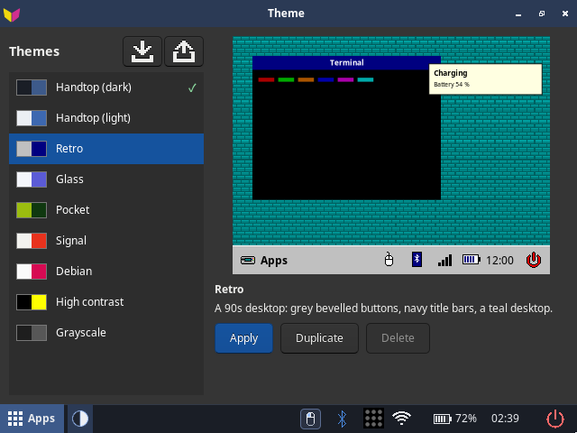
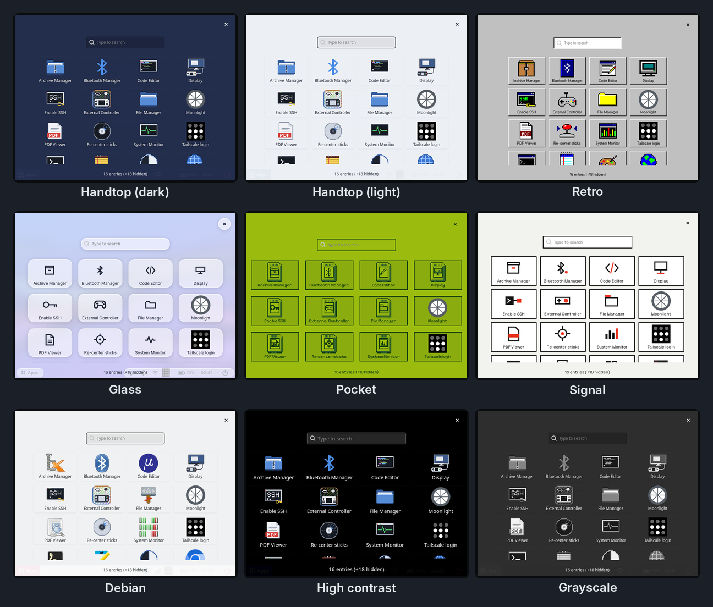
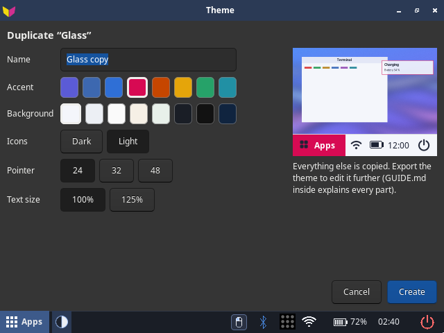
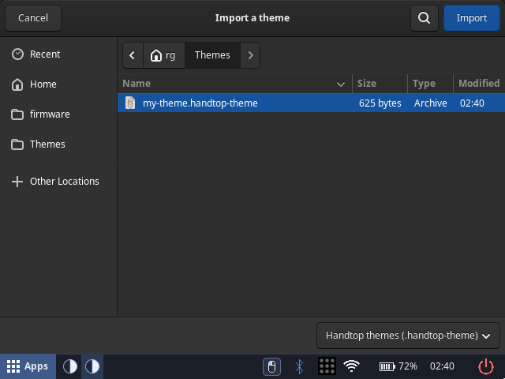
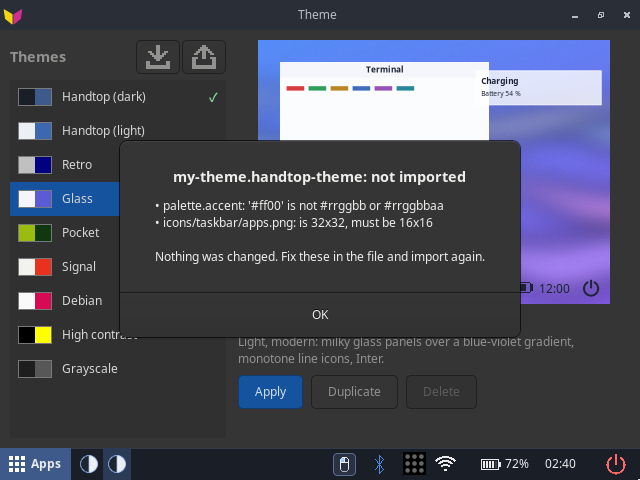

# Themes

A theme changes how the whole desktop looks: the taskbar and its icons, the app drawer, the power
menu, notifications, window title bars, the on-screen keyboard, the terminal, the pointer, fonts
and the wallpaper. Themes are only looks: they never change how anything works, and they can't run
anything.

## Change the theme

Open **Apps → Theme**. The themes are listed on the left with a preview on the right; pick one and
press **Apply**.

<p align="center">
  
</p>
 It switches at once. Only a new pointer waits for the next log-in, and the app offers
**Log out now** when that's the case.

Built in (shown here with the app drawer open):

<p align="center">
  
</p>

| Theme | Look |
|---|---|
| Handtop (dark) | the default |
| Handtop (light) | the same, light |
| Retro | a 90s desktop: grey bevelled buttons, navy title bars, a teal desktop, pixel art, a DOS-style terminal |
| Glass | light and see-through panels over a blue-to-violet gradient, a floating taskbar, line icons |
| Pocket | a pocket game console: four greens, a dot-matrix home screen, hearts for the battery, apps as cartridges |
| Signal | a minimal design object: warm white and black with one signal red |
| Debian | a stock Debian desktop (GNOME's Adwaita colours and pointer) |
| High contrast | white and yellow on black, thicker lines, bigger text and pointer |
| Grayscale | Handtop dark in greys |

To go back to the default at any time, apply **Handtop (dark)**, or run `rg35xxh-theme handtop-dark` in a
terminal or over SSH.

## Make your own copy

**Duplicate** makes an editable copy of the selected theme. You choose:

- a name;
- an accent and a background colour;
- dark or light icons;
- the pointer size;
- the text size.

The preview follows as you change things.

<p align="center">
  
</p>
 Your copies are listed under **Yours** and can be deleted;
the built-in themes can't.

## Share a theme

A theme travels as one file, `<name>.handtop-theme`.

- **Export** writes the selected theme to a file (to `~/Themes` unless you pick another folder, for
  example a USB drive). The file has `GUIDE.md` inside: everything a theme can change.
- **Import** installs a theme file. It is checked first: if something is wrong, the app lists every
  problem and nothing changes. A theme with the same id asks before replacing yours.

The two buttons above the theme list: **Import** (the tray with an arrow coming in) and **Export**
(the arrow going out). Both open a file picker that starts in `~/Themes`, with the boot partition
("firmware") and any USB drive or SD card in its sidebar:

<p align="center">
  
</p>

To move files between the handheld and a PC, use a USB drive or SD card, or copy over SSH
(`scp mytheme.handtop-theme rg@<handheld-ip>:`, then Import it from the home folder). The boot partition can be read from the
desktop but not written.

From a terminal:

| Command | Does |
|---|---|
| `rg35xxh-theme --list` | the installed themes |
| `rg35xxh-theme --get` | the current theme's id |
| `rg35xxh-theme ID` | apply a theme |
| `rg35xxh-theme --import FILE [--replace]` | install a theme file (prints the problems if it is refused) |
| `rg35xxh-theme --export ID FILE` | write a theme file |

## Design a theme from scratch

A `.handtop-theme` file is a zip of a theme folder:

```
theme.json            colours, fonts, wallpaper mode, pointer size, ... (the only required file)
images/wallpaper.png  the wallpaper (optional)
icons/...             taskbar, app, drawer and power-menu images (optional, exact sizes)
cursors/...           your own pointer (optional)
fonts/...             your own text and terminal fonts, with their licence (optional)
css/...               a little extra CSS for apps, taskbar, drawer and power menu (optional)
```

Everything you leave out comes from the base theme (`"base": "dark"` or `"light"`): a theme can be
a dozen colours in `theme.json` and nothing else. The full list of fields, colours and image
sizes is [theme-format.md](theme-format.md), the same text as the `GUIDE.md` in every exported theme.

The quickest way to start:

1. On the handheld, **Export** the theme closest to what you want (Handtop (light) for a light theme).
2. On a PC, unzip it, change `id` and `name` in `theme.json` (an id starting with `handtop-` is
   reserved for the built-in themes), then edit the colours and replace images.
3. Zip the folder's contents, rename the zip to `<id>.handtop-theme`, copy it to the handheld and
   **Import** it. Fix whatever the app lists, then **Apply**.

Check the result at 640×480: the taskbar, the app drawer (Apps), the power menu (Power), a
notification (plug in the charger), the on-screen keyboard (X) and a terminal.

## Design a theme with an AI agent

An AI agent can write a whole theme for you: the colours, and with a coding agent (one that can run
code on your PC, such as Claude Code or Codex) the images, the pointer and the CSS too.

Give it:

- **The format:** [theme-format.md](theme-format.md) (or the `GUIDE.md` from an exported theme). It
  is written so a person or an agent can follow it without anything else.
- **A starting point:** an exported theme, unzipped, so it sees a complete, working example.
- **Your idea:** what it should feel like, colours you like, references (a console, an old OS, a
  poster style), light or dark.

A prompt that works well:

> Make a Handtop theme for a 640×480 Linux handheld. The format is in theme-format.md; follow it
> exactly (field names, colour format, image paths and pixel sizes). Start from the exported theme
> in ./handtop-light. The look: _\<your idea\>_. Use id `my-theme` and name `My Theme`. Draw every
> image with code at its exact size, keep text readable on its background, and only use fonts and
> images that may be shared (say which licence in `license` and in fonts/LICENSE.txt). Put the
> result in ./my-theme and zip its contents as my-theme.handtop-theme.

Then import it on the handheld. If the import is refused, paste the list of problems back to the
agent; it says exactly which field or file is wrong:

<p align="center">
  
</p>

**If the agent can reach the handheld over SSH** (turn it on with **Apps → Enable SSH**), it can
test its own work: copy the file over, import and apply it, and take a screenshot to look at:

```sh
scp my-theme.handtop-theme rg@<handheld-ip>:
ssh rg@<handheld-ip> 'rg35xxh-theme --import ~/my-theme.handtop-theme --replace && rg35xxh-theme my-theme'
ssh rg@<handheld-ip> 'WAYLAND_DISPLAY=wayland-0 XDG_RUNTIME_DIR=/run/user/1000 grim ~/shot.png'
scp rg@<handheld-ip>:shot.png .
```

Good to know:

- Ask for small steps: first the palette only, look at it, then the wallpaper, then the icons.
- Pixel art looks best drawn at the exact size (or a whole-number multiple, scaled down by
  dropping pixels), not resized smoothly.
- A theme can't change the boot screen, sounds, behaviour or animations, and it can't run scripts;
  CSS that tries to load other files is refused.
- An agent may not know which fonts or images it is allowed to share. Check the licences before you
  share a theme.

## Sharing fields

Three optional fields in `theme.json` help when a theme is passed around:

- `version`: a whole number; raise it each time you share a changed theme.
- `license`: one line, for example `CC BY 4.0; fonts OFL 1.1`.
- `tags`: up to 8 short words, for example `["pixel", "retro"]`.

A theme works the same without them.

## Where things are

- Built-in themes: `/usr/share/rg35xxh/themes/`
- Yours: `~/.local/share/rg35xxh/themes/`
- The current choice: `~/.config/rg35xxh/theme`

How the Theme app works inside: [apps/theme.md](apps/theme.md).
